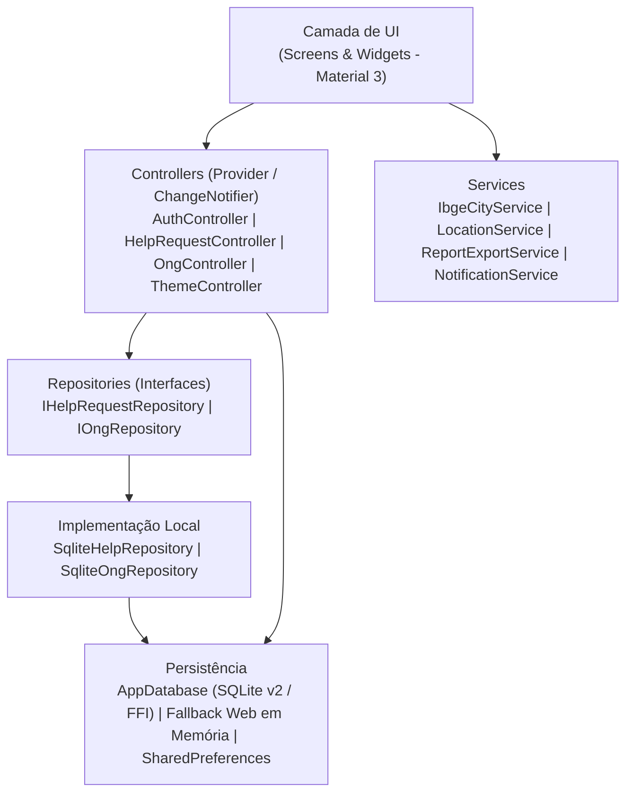

# 🐾 RedePatas 2.0

Aplicativo comunitário desenvolvido em **Flutter (Material 3)** para registrar, organizar e acompanhar pedidos de ajuda para animais em situação de rua que precisem de **Água**, **Alimento**, **Abrigo** ou **Socorro/Cuidados** em **Rio do Sul (SC)** e na região do **Alto Vale do Itajaí** — agora com uma suíte completa de gestão para **ONGs, protetores independentes e voluntários**.


> **Contexto Acadêmico**
> - **Curso:** Sistemas de Informação (Projeto de Extensão — Desenvolvimento e Cidadania)
> - **Disciplina:** Desenvolvimento para Plataforma Móvel
> - **Equipe:** Ariel Jahn e Lucas Gabriel Stopassoli
> - **Application ID (Android):** `br.edu.redepatas.redepatas`

---

## 📑 Sumário

- [Visão Geral e Perfis de Uso](#-visão-geral-e-perfis-de-uso)
- [Funcionalidades Completas](#-funcionalidades-completas)
- [Arquitetura e Estrutura do Projeto](#-arquitetura-e-estrutura-do-projeto)
- [Banco de Dados e Persistência (SQLite v2)](#-banco-de-dados-e-persistência-sqlite-v2)
- [Design System e Acessibilidade](#-design-system-e-acessibilidade)
- [Exemplos Práticos de Uso e Código](#-exemplos-práticos-de-uso-e-código)
- [Stack Tecnológica e Integrações](#-stack-tecnológica-e-integrações)
- [Como Executar e Testar](#-como-executar-e-testar)
- [Suíte de Testes Automatizados](#-suíte-de-testes-automatizados)
- [Limitações Conhecidas e Evolução Futura](#-limitações-conhecidas-e-evolução-futura)

---

## 👥 Visão Geral e Perfis de Uso

O RedePatas opera **100% localmente/offline** (com integrações opcionais online para IBGE e mapas OSM) e adapta atalhos e ferramentas conforme o perfil escolhido pelo usuário (`UserRole`), que pode ser alterado a qualquer momento em **Minha área**:

| Perfil (`UserRole`) | Descrição | Principais Recursos |
| --- | --- | --- |
| **Cidadão** (`citizen`) | Moradores que avistam animais precisando de auxílio | Registro de pedidos com foto e GPS, busca/mapa, acompanhamento da linha do tempo, adoção, doações via Pix e guia de maus-tratos |
| **Voluntário** (`volunteer`) | Pessoas dispostas a atuar em campo ou oferecer lar temporário | Todos os recursos de Cidadão + assumir pedidos, perfil de habilidades/veículo/raio de atuação, inscrição em mutirões e selos de conquista |
| **ONG / Protetor** (`organization`) | Instituições e coletivos de proteção animal | Todos os recursos acima + **Painel da ONG** (métricas, gráficos, alertas críticos > 2h, exportação PDF/CSV), cadastro de animais acolhidos, criação de eventos/mutirões e campanhas Pix |

> **Acesso rápido para demonstração:** na tela de boas-vindas (`WelcomeScreen`), é possível entrar instantaneamente em modo **Visitante / Demonstração** (Voluntário) ou **ONG Demo** (`APAD Rio do Sul`), já populados com dados reais de exemplo da região.

---

## ✨ Funcionalidades Completas

### 1. Onboarding, Boas-Vindas e Sessão Local
- **`OnboardingScreen`**: guia inicial em 4 etapas apresentando a proposta da rede, o fluxo de atendimento, as ferramentas para ONGs e as boas práticas de segurança e privacidade.
- **`WelcomeScreen`**: apresenta contadores animados ao vivo (*Abertos agora*, *Em apoio*, *Casos na rede*), benefícios principais, acesso via login/cadastro local e entrada rápida em modo demonstração.
- **`RoleSelectionScreen`**: seleção do perfil de atuação (*Cidadão*, *Voluntário* ou *ONG / Protetor*), persistido via `SharedPreferences`.

### 2. Mural Comunitário, Busca e Mapa OpenStreetMap
- **`HomeRequestsScreen`**:
  - Resumo regional com totais de casos abertos, urgentes e concluídos.
  - Filtros rápidos por categoria (**Todos**, **Água**, **Alimento**, **Abrigo**, **Urgentes**, **Concluídos**) e por cidade.
  - Priorização automática: pedidos ativos aparecem antes dos concluídos, ordenados por maior urgência e maior tempo de espera.
  - Ordenação **"Perto de mim"** com cálculo de distância **Haversine** (`LocationService`) via GPS do aparelho (com fallback seguro para o Centro de Rio do Sul caso o GPS esteja indisponível).
  - Alternância fluida entre visualização em **Lista** e **Mapa**.
- **`RequestsMapScreen`**:
  - Mapa interativo com tiles do **OpenStreetMap** (`flutter_map` + `latlong2`).
  - Pins coloridos por status/urgência, bottom sheet com resumo do caso e botão **Abrir rota no mapa** (Google Maps).
  - Modo seletor (`isPickerMode: true`) usado na criação de novos pedidos para marcar o ponto exato.
- **`SearchRequestsScreen`**: busca textual dedicada (título, bairro, cidade, ponto de referência, espécie e necessidades) combinada com filtros de urgência e limpeza rápida.

### 3. Registro de Pedidos de Ajuda
- **`NewRequestScreen`**:
  - Dica contextual exibida apenas no primeiro uso.
  - Seleção de espécie (**Cão**, **Gato**, **Outro**), múltiplas necessidades (**Água**, **Alimento**, **Abrigo**, **Socorro/Cuidados**) e nível de urgência (**Normal**, **Alta**, **Crítica**).
  - Seletor de cidade integrado à **API pública do IBGE** (municípios de Santa Catarina, com cache e fallback regional offline) e lista pré-configurada com **25 bairros de Rio do Sul**.
  - Captura de foto via **Câmera** ou **Galeria** (`image_picker`), marcação de coordenadas via GPS ou mapa interativo.
  - **Detecção automática de duplicidade** (`findPossibleDuplicate`): alerta caso já exista pedido ativo da mesma espécie no mesmo bairro nas últimas 24h.

### 4. Ciclo de Vida do Caso, Linha do Tempo e Minhas Ações
- **`RequestDetailScreen`**:
  - Visualizador de foto em tela cheia e stepper animado de status: **`Aberto` → `Em atendimento` → `Concluído`** (com opção de reabrir).
  - Botão **Quero Ajudar este Animal** com registro de compromisso do voluntário.
  - **Linha do tempo cronológica (`case_updates`)** registrando criação, assunção, atualizações e conclusão do caso.
  - Ações integradas: seguir/salvar pedido, compartilhar texto formatado, editar informações, contato direto via **WhatsApp**, abrir rota no mapa, **convocar voluntários compatíveis** (baseado em habilidades/veículo), reportar spam/duplicidade e converter o caso em animal acolhido para adoção.
- **`MyActionsScreen`**: organizada em 3 abas — **Estou ajudando**, **Criados por mim** e **Seguindo**.

### 5. Painel da ONG e Prestação de Contas
- **`OrgDashboardScreen`**:
  - Filtro por período: **Últimos 7 dias**, **Últimos 30 dias** ou **Todo o período**.
  - Indicadores-chave: pedidos abertos, em atendimento, concluídos e **tempo médio de resolução** (em horas).
  - **Alertas de casos críticos em atraso**: destaca pedidos críticos abertos há mais de 2 horas (`>= 120 min`).
  - Gráfico de distribuição por necessidade construído com **`fl_chart`**.
  - **Exportação de relatórios** (`ReportExportService`): geração e compartilhamento de relatório executivo em **PDF** (`pdf`) e planilha completa em **CSV** (`csv`).

### 6. Adoção Responsável e Animais Acolhidos
- **`AdoptionScreen`**:
  - Vitrine pública de animais acolhidos com filtros por status (**Todos**, **Disponível**, **Lar temporário**, **Adotado**).
  - Informações completas de saúde e perfil (espécie, sexo, faixa etária, porte, temperamento, vacinação e castração).
  - Formulário de manifestação de interesse, compartilhamento formatado e contato direto via WhatsApp.
  - Cadastro de novos animais habilitado para perfis **ONG / Protetor**.

### 7. Eventos, Mutirões, Diretório de ONGs e Voluntários
- **`EventsOngsScreen`** (2 abas):
  - **Mutirões e Eventos**: listagem de feiras de adoção, mutirões e ações comunitárias com inscrição/cancelamento em 1 toque, contador de vagas, controle de presença, lembrete local (`flutter_local_notifications`), criação de eventos por ONGs e exportação da lista de inscritos em **CSV**.
  - **ONGs e Voluntários**: diretório de organizações parceiras (com selo de verificação, contatos, Instagram e chave Pix) e cadastro/visualização do perfil de voluntário (habilidades como *Transporte*, *Abrigo temporário*, *Alimentação*, *Resgate*, disponibilidade, veículo próprio e raio de atuação em km).

### 8. Doações e Campanhas Pix
- **`CampaignsScreen`**:
  - Campanhas de arrecadação de **itens** (ex.: kg de ração) ou **financeiras** (R$).
  - Barra de progresso animada com percentual atingido e prazo.
  - Botão **Copiar Pix** em 1 toque (área de transferência) e registro de doações atualizando automaticamente o progresso da campanha.

### 9. Guia de Denúncia de Maus-Tratos
- **`AbuseReportScreen`**:
  - Orientação legal baseada na **Lei Federal nº 14.064/2020**.
  - Botões de discagem direta para autoridades: **Polícia Militar (`190`)**, **Bombeiros (`193`)** e **Disque-Denúncia SC (`181`)**.
  - Checklist estruturado de evidências (endereço, risco imediato, fotos/vídeos, testemunhas e relato) com geração de **resumo compartilhável**.

### 10. Minha Área, Conquistas e Personalização
- **`ProfileGuideScreen`**:
  - Resumo de impacto pessoal, edição de perfil, troca de papel (`RoleSelectionScreen`) e **selos de conquista** (*Primeira ajuda*, *5 resgates concluídos*, *Olhar atento*, *Presença em mutirão*).
  - Seletor de tema (**Claro**, **Escuro**, **Sistema**), preferências de notificações locais, backup em JSON, guia de abordagem segura, contatos úteis regionais e revisão do onboarding.

---

## 🏗️ Arquitetura e Estrutura do Projeto

O projeto segue uma arquitetura em camadas inspirada em **MVC + Repository Pattern**, com gerenciamento de estado reativo via **Provider (`ChangeNotifier`)** e injeção de dependências no entrypoint (`main.dart`) para facilitar testes unitários e futura migração para backend em nuvem.



### Árvore de Diretórios

```text
redepatas/
├── assets/
│   └── icon/icon.png                     # Ícone oficial do aplicativo
├── lib/
│   ├── main.dart                         # Bootstrap, MultiProvider, AuthGate e MaterialApp
│   ├── controllers/
│   │   ├── auth_controller.dart          # Sessão local, papéis (UserRole), onboarding e dicas
│   │   ├── help_request_controller.dart  # Feed, filtros, priorização, busca e pedidos seguidos
│   │   └── ong_controller.dart           # ONGs, voluntários, timeline, adoção, eventos, campanhas e métricas
│   ├── core/
│   │   ├── constants/
│   │   │   └── rio_do_sul_bairros.dart   # Lista com 25 bairros de Rio do Sul - SC
│   │   ├── database/
│   │   │   └── app_database.dart         # SQLite v2 (10 tabelas), migração v1->v2 e seeds iniciais
│   │   ├── services/
│   │   │   ├── ibge_city_service.dart    # API IBGE (SC) com cache e fallback regional offline
│   │   │   ├── location_service.dart     # GPS (Geolocator) e cálculo de distância Haversine
│   │   │   ├── notification_service.dart # Notificações locais e preferências
│   │   │   └── report_export_service.dart# Exportação PDF, CSV, backup JSON e compartilhamento
│   │   └── theme/
│   │       ├── app_theme.dart            # Paleta terrosa, ThemeData em cache e AppSemanticColors
│   │       ├── app_tokens.dart           # Tokens: AppSpacing, AppSizes, AppRadius e AppMotion
│   │       └── theme_controller.dart     # Persistência do ThemeMode (light/dark/system)
│   ├── models/
│   │   ├── campaign_model.dart           # CampaignModel, CampaignKind e DonationModel
│   │   ├── case_update_model.dart        # CaseUpdateModel e CaseUpdateType
│   │   ├── event_model.dart              # CommunityEventModel, EventType e EventSignupModel
│   │   ├── help_request_model.dart       # HelpRequestModel e enums (Species, Need, Status, Urgency)
│   │   ├── organization_model.dart       # OrganizationModel e VolunteerProfileModel
│   │   ├── shelter_animal_model.dart     # ShelterAnimalModel, AnimalStatus e AdoptionInterestModel
│   │   └── user_model.dart               # UserModel e UserRole
│   ├── repositories/
│   │   ├── i_help_request_repository.dart
│   │   ├── i_ong_repository.dart
│   │   ├── sqlite_help_repository.dart
│   │   └── sqlite_ong_repository.dart
│   └── ui/
│       ├── screens/                      # 16 telas completas (Onboarding, Welcome, Shell, Mapa, ONG, etc.)
│       └── widgets/                      # AppButton, EmptyState, RequestCard, SectionHeader, Badges
├── test/
│   └── widget_test.dart                  # Suíte completa de testes unitários e de widget
├── pubspec.yaml
├── sys_context.json
└── README.md
```

---

## 💾 Banco de Dados e Persistência (SQLite v2)

O banco local `redepatas_v1.db` é gerenciado por `AppDatabase` (`lib/core/database/app_database.dart`):

- **Mobile (Android/iOS):** `sqflite`.
- **Desktop (Windows/Linux/macOS):** `sqflite_common_ffi`.
- **Web (`kIsWeb`):** fallback automático em memória pré-populado com `AppDatabase.initialSeed*()`.
- **Migração segura (`v1 → v2`):** em `onUpgrade`, verifica colunas existentes via `PRAGMA table_info(help_requests)`, adiciona colunas v2 sem perda de dados legados (`latitude`, `longitude`, `organizationId`, `updatedAt`, `completedAt`, `photos`, `animalCount`, `afterPhotoPath`, `reportedReason`) e cria as novas tabelas de gestão comunitária.

### Tabelas do Schema v2

| Tabela | Responsabilidade |
| --- | --- |
| `help_requests` | Pedidos de ajuda comunitários (dados do animal, necessidades, urgência, status, coordenadas, autor e voluntário) |
| `case_updates` | Linha do tempo cronológica de cada caso (criação, assunção, atualizações, conclusão) |
| `organizations` | Cadastro de ONGs/coletivos parceiros, contatos, redes sociais e chave Pix |
| `volunteers` | Perfis de voluntários com habilidades, disponibilidade, veículo e raio em km |
| `shelter_animals` | Animais acolhidos disponíveis para adoção ou lar temporário |
| `adoption_interests` | Manifestações de interesse em adoção vinculadas a cada animal |
| `events` | Feiras de adoção, mutirões e eventos comunitários |
| `event_signups` | Inscrições e controle de presença em eventos |
| `campaigns` | Campanhas de arrecadação de suprimentos ou recursos via Pix |
| `donations` | Registro de doações vinculadas às campanhas |

### Dados Iniciais de Demonstração (Seeds)
Ao inicializar o banco pela primeira vez, o app semeia automaticamente dados realistas de Rio do Sul:
- **3 pedidos de ajuda:** *Cão caramelo* (Centro, Normal, Aberto), *Gata cinza* (Canoas, Alta, Em atendimento) e *Filhote malhado* (Santana, Crítica, Aberto).
- **2 organizações:** *APAD Rio do Sul* e *Patas do Alto Vale*.
- **3 animais para adoção/lar temporário:** *Paçoca* (cão adulto), *Luna* (gata filhote — lar temporário) e *Thor* (cão idoso).
- **2 eventos:** *Feira de Adoção na Praça Ermembergo* e *Mutirão de Alimentação e Limpeza do Abrigo*.
- **2 campanhas:** *Ração para cães e gatos do mês* (meta 120 kg) e *Fundo de Castração Solidária* (meta R$ 1.800).

---

## 🎨 Design System e Acessibilidade

O visual do RedePatas segue uma identidade **minimalista, sóbria e acolhedora**, sem gradientes excessivos, com superfícies planas, bordas de 1px e ícones Material Outlined:

| Token / Elemento | Tema Claro | Tema Escuro |
| --- | --- | --- |
| **Primária (Terracota)** | `#C85A32` | `#E07A5F` |
| **Secundária (Caramelo)** | `#D48C46` | `#D48C46` |
| **Terciária (Verde Sálvia)** | `#5F7A61` | `#5F7A61` |
| **Fundo (`background`)** | `#FAF6F0` (areia/creme) | `#1A1412` (terra noturna) |
| **Superfície (`surface`)** | `#FFFFFF` | `#261E1B` |
| **Contorno (`outline`)** | `#E2D5C8` | `#4A3B35` |

### Destaques de UX e Acessibilidade
- **Transição suave de tema:** `ThemeData` em cache com `ThemeExtension<AppSemanticColors>` interpolável em `300ms` (`AppMotion.normal`).
- **Alvos de toque confortáveis:** mínimo absoluto de `48dp` (`AppSizes.tapMin`), botões primários com `56dp` (`AppSizes.buttonHeight`) e barra de navegação flutuante em pílula (`_FloatingPillNavigationBar`).
- **Tipografia e escalonamento:** fonte `Inter`, texto legível (`>= 14px`) e layouts validados em telas compactas (`360x640`) com `textScaler` de `1.3x` sem overflow.
- **Movimento reduzido:** `AppMotion.duration(context, ...)` respeita automaticamente `MediaQuery.disableAnimations`.

---

## 💡 Exemplos Práticos de Uso e Código

### Fluxo 1 — Cidadão registra um animal em situação de risco
1. Acesse a aba central **Novo (`+`)** na barra flutuante.
2. Escolha a espécie (*Cão*), selecione necessidades (*Alimento*, *Abrigo*) e urgência (*Crítica*).
3. Selecione a cidade (*Rio do Sul*), o bairro (*Santana*), informe o ponto de referência e adicione uma foto ou marque o ponto no mapa.
4. Ao publicar, o app verifica duplicidades nas últimas 24h, salva no SQLite, registra o evento inicial em `case_updates` e redireciona ao Mural Comunitário.

### Fluxo 2 — Voluntário assume e conclui o atendimento
1. No Mural ou no Mapa, abra o caso desejado (`RequestDetailScreen`).
2. Toque em **Quero Ajudar este Animal**, descreva seu compromisso (ex.: *"Levando ração e caixa de transporte"*) e confirme.
3. O status muda para **Em atendimento**, a linha do tempo é atualizada e o caso passa a constar na aba **Pedidos → Estou ajudando**.
4. Ao finalizar, toque em **Marcar ajuda como Concluída** (registrando `completedAt` para o cálculo do tempo médio no Painel da ONG).

### Fluxo 3 — ONG gera prestação de contas em PDF/CSV
1. Entre como **ONG / Protetor** (ou use **ONG Demo**).
2. Abra **Painel da ONG**, selecione o período (*Últimos 30 dias*), analise os alertas críticos e o gráfico de necessidades.
3. Toque em exportar **PDF** ou **CSV** para compartilhar o documento imediatamente.

### Exemplos de Código da Aplicação

#### Cálculo de distância Haversine (`LocationService`)
```dart
import 'package:redepatas/core/services/location_service.dart';

// Distância entre o Centro de Rio do Sul e o bairro Canoas
final double km = LocationService.distanceKm(
  -27.2156, -49.6431,
  -27.2241, -49.6289,
);
print(LocationService.formatDistance(km)); // ex: "1,7 km"
```

#### Exportação de Relatório PDF e CSV (`ReportExportService`)
```dart
import 'package:redepatas/core/services/report_export_service.dart';

// Gerar planilha CSV dos pedidos
final String csvContent = ReportExportService.buildRequestsCsv(requests);

// Gerar relatório executivo em PDF (A4)
final Uint8List pdfBytes = await ReportExportService.buildOngReportPdf(
  orgName: 'APAD Rio do Sul',
  periodLabel: 'Últimos 30 dias',
  metrics: metrics,
  requests: requests,
);
```

#### Injeção de Repositório em Memória para Testes
```dart
await tester.pumpWidget(
  RedePatasApp(
    repository: InMemoryHelpRepository(),
    ongRepository: InMemoryOngRepository(),
  ),
);
```

---

## 🧰 Stack Tecnológica e Integrações

| Categoria | Pacotes / Tecnologias |
| --- | --- |
| **Framework & UI** | `flutter` (Material 3), `google_fonts`, `cupertino_icons`, `fl_chart` |
| **Estado** | `provider` (`ChangeNotifier`, `MultiProvider`, `Selector`) |
| **Persistência Local** | `sqflite`, `sqflite_common_ffi`, `path`, `path_provider`, `shared_preferences` |
| **Mapas & Localização** | `flutter_map` (OpenStreetMap), `latlong2`, `geolocator` |
| **Exportação & Compartilhamento** | `pdf`, `printing`, `csv`, `share_plus` |
| **Mídia, Rede & Sistema** | `http` (API IBGE), `image_picker`, `url_launcher` (WhatsApp/Telefone/Maps), `flutter_local_notifications`, `intl`, `uuid` |
| **Qualidade & Assets (dev)** | `flutter_test`, `flutter_lints`, `flutter_launcher_icons` |

### Integrações Externas
- **API de Localidades do IBGE:** `GET https://servicodados.ibge.gov.br/api/v1/localidades/estados/SC/municipios?orderBy=nome` (timeout de 8s, cache em memória e fallback automático com cidades do Alto Vale do Itajaí).
- **OpenStreetMap:** tiles cartográficos renderizados via `flutter_map`.
- **Apps Externos (`url_launcher`):** abertura de conversa no **WhatsApp**, discador telefônico (`190`, `193`, `181`) e rotas no **Google Maps**.

---

## 🚀 Como Executar e Testar

### Pré-requisitos
- **Flutter SDK** instalado e configurado no `PATH`
- **Dart SDK `^3.13.4`**
- Emulador Android/iOS, navegador (Chrome) ou ambiente Desktop (Windows/Linux/macOS)

### Comandos Principais

```bash
# 1. Instalar dependências
flutter pub get

# 2. Análise estática de código (lints)
flutter analyze

# 3. Executar a suíte de testes unitários e de widgets
flutter test

# 4. Rodar o aplicativo (dispositivo conectado, emulador, web ou desktop)
flutter run
```

### Comandos Utilitários

```bash
# Rodar especificamente no Chrome (Web) ou Windows
flutter run -d chrome
flutter run -d windows

# Gerar APK de release para Android
flutter build apk --release

# Regerar ícones de inicialização (Android e iOS) a partir de assets/icon/icon.png
dart run flutter_launcher_icons
```

---

## 🧪 Suíte de Testes Automatizados

O arquivo [`test/widget_test.dart`](test/widget_test.dart) valida a aplicação de ponta a ponta sem depender de rede ou disco real (usando `InMemoryHelpRepository`, `InMemoryOngRepository`, `MockClient` para o IBGE, `SharedPreferences.setMockInitialValues` e `sqflite_common_ffi`):

- **Fluxo principal E2E:** Onboarding → Boas-Vindas (validação de botão `>= 56dp`) → Login Demo → Mural Comunitário → Detalhes do Pedido → Assumir compromisso → Navegação entre abas → Troca de tema Claro/Escuro.
- **Tema e Design System:** cache de `ThemeData`, validação exata da paleta terrosa e presença de `AppSemanticColors`.
- **Migração SQLite `v1 → v2`:** cria banco legado v1, abre com `SqliteHelpRepository` v2 e confirma preservação integral dos registros.
- **Métricas, Geo e Relatórios:** cálculo de tempo médio de resolução, detecção de críticos em atraso (> 2h), distância Haversine, progresso de campanhas e geração de CSV/PDF.
- **IBGE e Bairros:** valida lista de bairros de Rio do Sul, resposta online mockada e fallback offline.
- **Acessibilidade e QA:** renderização em viewport compacta `360x640` com `textScaler: 1.3` sem exceções ou overflow.
- **Regras de Domínio e Widgets v2:** retrocompatibilidade de `HelpRequestModel`, detecção de duplicidade (24h), botão **Copiar Pix**, inscrição em evento com atualização de vagas e troca de papel em `RoleSelectionScreen`.

---

## 🗺️ Limitações Conhecidas e Evolução Futura

### Limitações Atuais
- **Armazenamento local:** não há backend ou sincronização em tempo real entre dispositivos; os dados ficam no banco SQLite do aparelho (e em memória volátil na versão Web).
- **Autenticação local:** o login é simulado localmente via `SharedPreferences` (sem senha ou servidor de autenticação).
- **Mídia local:** fotos anexadas aos pedidos são salvas como caminho local no dispositivo.

### Próximos Passos (Roadmap)
- Implementar `IHelpRequestRepository` e `IOngRepository` com **Firebase** ou **Supabase** (sem alterar a camada de UI ou controllers).
- Armazenamento em nuvem (Storage) para fotos de antes/depois dos resgates.
- Autenticação real com perfis verificados para ONGs e notificações push para alertas críticos próximos ao voluntário.
